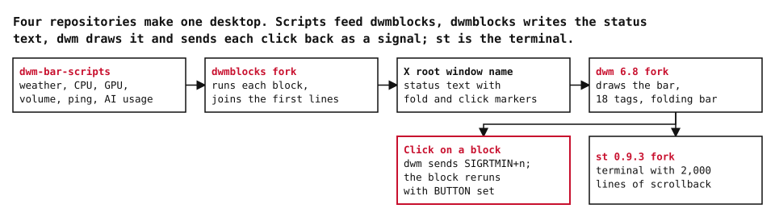

# dwmblocks: clickable, folding status bar

[Polski](README.pl.md)

A local fork of torrinfail's C status-bar program for dwm. It runs the commands
in [blocks.h](blocks.h), combines their first output lines and publishes the
result to the X root window.



## Local changes

- Blocks with a signal number carry click markers. Queued signals at
  `SIGRTMIN + number` pass the mouse button to the command as `BUTTON`.
- A block with no command emits `0x1f`, separating the hover-only part from the
  always-visible part in the companion dwm fork.
- Real-time signals are masked during normal status rebuilding; interrupted
  sleeps resume so clicks do not advance the refresh counter early.

Commands still run sequentially. A slow command can delay the entire bar;
[ping-artix](https://github.com/maciejszulia/dwm-bar-scripts/blob/main/ping-artix)
uses a background measurement and a cached result for that reason.

## Build and configure

Requires a C compiler, make and Xlib development files.

```sh
make
```

This checkout **tracks `blocks.h`**. `make` copies `blocks.def.h` only when
`blocks.h` is absent; it does not replace the tracked local configuration.
The two files have different layouts. Review the commands before running
`./dwmblocks` inside an X session. `make install` installs to `/usr/local/bin`
by default; `PREFIX` and `DESTDIR` can be overridden.

| Dependency | Why it is needed |
|---|---|
| [Companion dwm fork](https://github.com/maciejszulia/dwm) | Renders colour/fold markers and sends per-block click signals. |
| [Bar scripts](https://github.com/maciejszulia/dwm-bar-scripts) | Usage, weather, volume, brightness, GPU and ping commands; paths currently use `~/.local/bin`. |
| [cpu helper](https://github.com/maciejszulia/dwm-bar-scripts/blob/main/cpu) | CPU and optional ThinkPad fan readings. Needs compatible Linux proc/sysfs data; the current CPU block has signal `0`, so it receives no mouse actions. |
| Host tools and hardware | `free`, `df`, `ip`, `notify-send`, `wg-quick`, battery sysfs, the Polish locale and the scripts' own dependencies. |

The VPN block's left click runs `sudo -n wg-quick up/down mvd`; it is an action,
not just a status display. Adapt or remove host-specific blocks before use.
The CPU helper supports optional fan requests if wired for clicks, but their
consumer (`wiatrak`) is a separate service, not installed by these repositories.
The `-p` option still executes the configured commands and requires X in the
normal build, so it is not an isolated test mode.

## Licence

Based on torrinfail's dwmblocks. Preserve the author attribution and
[ISC licence](LICENSE). No automated test suite is included; compilation alone
does not validate the local commands or interaction with dwm.
