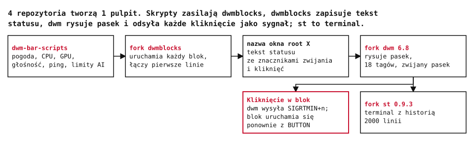

# dwmblocks: klikalny, zwijany pasek stanu

[English](README.md)

Lokalny fork programu paska stanu dla dwm, który torrinfail napisał w C. Program uruchamia komendy z [blocks.h](blocks.h), łączy pierwszą linię wyjścia każdej komendy i zapisuje wynik w oknie root X.



## Lokalne zmiany

- Bloki z numerem sygnału mają znaczniki kliknięć. Kolejkowane sygnały `SIGRTMIN + numer` przekazują przycisk myszy do komendy w zmiennej `BUTTON`.
- Blok bez komendy wypisuje bajt `0x1f`. Ten bajt oddziela w towarzyszącym forku dwm część widoczną po najechaniu kursorem od części zawsze widocznej.
- Podczas zwykłej przebudowy stanu program maskuje sygnały czasu rzeczywistego. Przerwane uśpienie trwa dalej, więc kliknięcie nie przyspiesza licznika odświeżania.

Komendy nadal działają po kolei. Wolna komenda opóźnia cały pasek. Dlatego [ping-artix](https://github.com/maciejszulia/dwm-bar-scripts/blob/main/ping-artix) mierzy w tle i pokazuje wynik z pamięci podręcznej.

## Budowa i konfiguracja

Wymagane są: kompilator C, make i pliki deweloperskie Xlib.

```sh
make
```

To repozytorium **śledzi `blocks.h`**. `make` kopiuje `blocks.def.h` tylko wtedy, gdy `blocks.h` nie istnieje. `make` zostawia śledzoną lokalną konfigurację bez zmian. Oba pliki mają różny układ. Przejrzyj komendy, zanim uruchomisz `./dwmblocks` w sesji X. `make install` instaluje program domyślnie w `/usr/local/bin`; zmienne `PREFIX` i `DESTDIR` zmieniają ten katalog.

| Zależność | Powód |
|---|---|
| [Towarzyszący fork dwm](https://github.com/maciejszulia/dwm) | Rysuje znaczniki kolorów i zwijania oraz wysyła sygnały kliknięć do każdego bloku. |
| [Skrypty paska](https://github.com/maciejszulia/dwm-bar-scripts) | Komendy dla limitów, pogody, głośności, jasności, GPU i pingu; ścieżki wskazują `~/.local/bin`. |
| [Skrypt cpu](https://github.com/maciejszulia/dwm-bar-scripts/blob/main/cpu) | Odczyt CPU i opcjonalnie wentylatora ThinkPada. Skrypt wymaga zgodnych danych linuksowych w proc i sysfs. Blok CPU ma sygnał `0`, więc nie odbiera kliknięć. |
| Narzędzia i sprzęt hosta | `free`, `df`, `ip`, `notify-send`, `wg-quick`, bateria w sysfs, polskie locale i zależności samych skryptów. |

Kliknięcie lewym przyciskiem w blok VPN uruchamia `sudo -n wg-quick up/down mvd`. Ten blok wykonuje działanie i nie tylko pokazuje stan. Przed użyciem dostosuj albo usuń bloki zależne od hosta. Skrypt cpu obsługuje opcjonalne żądania dla wentylatora po podłączeniu kliknięć. Odbiorca tych żądań (`wiatrak`) to osobna usługa spoza tych repozytoriów. Opcja `-p` nadal wykonuje skonfigurowane komendy i w zwykłej kompilacji wymaga X, więc nie jest trybem testu w izolacji.

## Licencja

Fork bazuje na dwmblocks autorstwa torrinfail. Zachowaj informację o autorze i [licencję ISC](LICENSE). Repozytorium nie ma automatycznych testów. Sama kompilacja nie sprawdza lokalnych komend ani współpracy z dwm.
