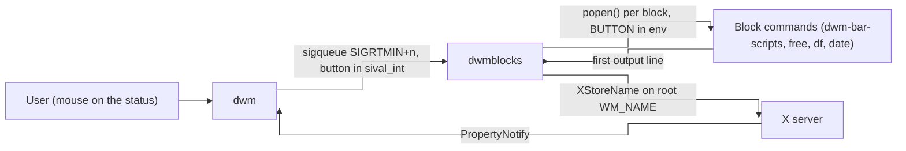
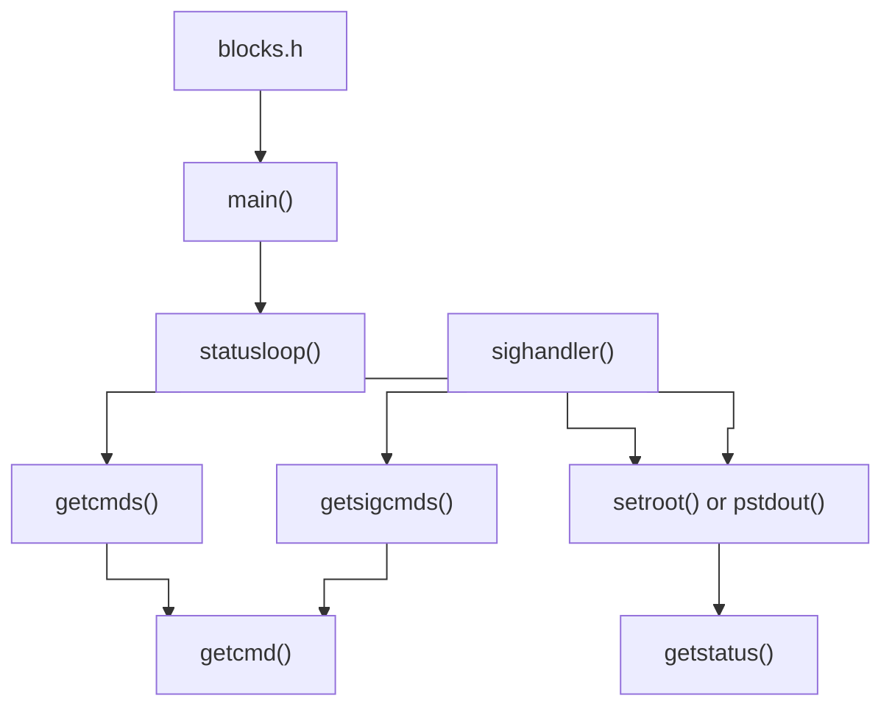
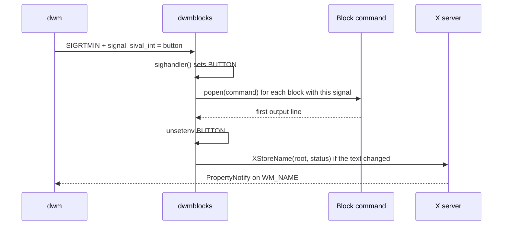

# dwmblocks fork: architecture

This document describes the architecture of this dwmblocks fork in the arc42
layout. The program is one C file, [dwmblocks.c](../../dwmblocks.c), configured
by the header [blocks.h](../../blocks.h).

## 1 Introduction and goals

dwmblocks builds the status text for dwm. It runs one shell command per
block, takes the first output line of each command, joins the lines and
writes the result to the `WM_NAME` property of the X root window. This fork
adds these functions to upstream dwmblocks:

- click markers: a block with a signal number is wrapped in its signal byte,
  and a click arrives as a queued real-time signal with the mouse button;
- a fold marker: a block without a command emits the byte `0x1f`;
- real-time signals are blocked while the status is rebuilt, and an
  interrupted sleep resumes.

Quality goals, in priority order:

1. A click runs only the clicked block and does not shift the refresh schedule.
2. The status text is never corrupted by a signal that arrives during a rebuild.
3. The configuration is one tracked header that a fresh clone builds as is.

## 2 Constraints

| Constraint | Evidence |
|---|---|
| C, built by `make` with `-pedantic -Wall -Os`, linked with `-lX11`. | [Makefile](../../Makefile) |
| Configuration is compiled in from `blocks.h`. | `#include "blocks.h"` in [dwmblocks.c](../../dwmblocks.c) |
| Each block output is limited to `CMDLENGTH` (128) bytes. | [dwmblocks.c](../../dwmblocks.c) |
| On OpenBSD the code uses `SIGUSR1` offsets instead of `SIGRTMIN`. | `SIGPLUS`, `SIGMINUS` in [dwmblocks.c](../../dwmblocks.c) |
| Upstream ISC licence and author attribution stay in place. | [LICENSE](../../LICENSE) |

## 3 Context and scope

In scope: scheduling, signal handling and assembly of the status text.
Out of scope: drawing (dwm), the block scripts
([dwm-bar-scripts](https://github.com/maciejszulia/dwm-bar-scripts)) and the
host tools they call.

## 4 Solution strategy

- Keep the upstream single-thread loop: one tick per second, each block runs
  when the tick counter is a multiple of its interval.
- Track `blocks.h` in git ([ADR 0001](adr/0001-track-blocks-h.md)).
- Carry click and fold information inside the status text and pass the mouse
  button through a queued signal
  ([ADR 0002](adr/0002-button-in-queued-signal.md),
  [ADR 0003](adr/0003-fold-marker-block.md)).
- Block real-time signals during the rebuild and resume the sleep after a
  signal ([ADR 0004](adr/0004-mask-signals-during-rebuild.md)).

## 5 Building block view

| Function | Responsibility |
|---|---|
| `main()` | Parses `-d <delimiter>` and `-p`, opens the X display, installs `SIGTERM`/`SIGINT` handlers, calls `statusloop()`. |
| `statusloop()` | Calls `getcmds()` once per tick with real-time signals blocked, writes the status, sleeps 1 s. |
| `getcmds(time)` | Runs each block whose interval divides `time`; `time == -1` runs all blocks. |
| `getcmd(block, output)` | Runs one command with `popen()`, adds the icon, the signal bytes and the delimiter; a block without a command returns `0x1f`. |
| `setupsignals()` / `sighandler()` | Registers a handler for `SIGRTMIN + signal` of each block; the handler sets `BUTTON`, runs the matching blocks and writes the status. |
| `getstatus()` / `setroot()` / `pstdout()` | Joins the block outputs; writes them to the root window only when the text changed (`-p` prints to stdout instead). |
| [blocks.h](../../blocks.h) | Block table (icon, command, interval, signal) and delimiter. |
| [blocks.def.h](../../blocks.def.h) | Template that `make` copies when `blocks.h` is absent. |

## 6 Runtime view

### Click on a block

### Tick

`statusloop()` blocks all real-time signals, calls `getcmds(i++)` and
`writestatus()`, then unblocks the signals. It sleeps for 1 s with
`nanosleep()` and resumes the remaining time after `EINTR`, so a click does
not start the next tick early.

## 7 Deployment view

`make` builds the binary `dwmblocks`. `make install` copies it to
`${DESTDIR}${PREFIX}/bin`; the default `PREFIX` is `/usr/local`
([Makefile](../../Makefile)). The binary runs inside an X session next to dwm.
The repository has no CI workflow.

## 8 Crosscutting concepts

- **Status-text protocol.** A block with a non-zero signal starts and ends
  with its signal byte (`getcmd()`). Bytes `\001` to `\005` in icons and
  outputs select dwm colour schemes. The tracked `blocks.h` uses signals 6, 7,
  8, 10, 11, 12 and 13; signal 0 means "no click".
- **Write only on change.** `setroot()` and `pstdout()` compare the new text
  with the previous text and skip unchanged output.
- **Sequential commands.** All commands run one after another in one thread;
  a slow command delays the whole bar ([README.md](../../README.md)).

## 9 Architecture decisions

- [ADR 0001: Track blocks.h in git](adr/0001-track-blocks-h.md)
- [ADR 0002: Pass the mouse button in a queued signal](adr/0002-button-in-queued-signal.md)
- [ADR 0003: A block without a command is the fold marker](adr/0003-fold-marker-block.md)
- [ADR 0004: Mask real-time signals during the rebuild](adr/0004-mask-signals-during-rebuild.md)

## 10 Quality requirements

| Quality | Scenario | Check |
|---|---|---|
| Schedule stability | A burst of wheel ticks does not make interval blocks run out of turn. | Measurement in commit `4b3dcb0`; no automated test. |
| Integrity | A signal during `getstatus()` does not duplicate text or overflow `STATUSLENGTH`. | Signal mask in `statusloop()`; no automated test. |
| Buildability | `make` builds a fresh clone. | No CI; [README.md](../../README.md) states that no automated test suite is included. |

## 11 Risks and technical debt

- Commands run sequentially; a slow command freezes the bar. The
  `ping-artix` block works around this with a cache (commit `e638efa`).
- `blocks.h` calls scripts by absolute paths in the home directory and host
  tools (`wg-quick`, battery sysfs). Another machine must adapt it.
- The VPN block runs `sudo -n wg-quick` on click; it changes system state
  ([README.md](../../README.md)).
- `blocks.def.h` and `blocks.h` have different layouts, so changes to one do
  not reach the other ([README.md](../../README.md)).
- No CI and no automated tests.

### Open questions

- None.

## 12 Glossary

| Term | Meaning |
|---|---|
| Block | One entry in `blocks[]`: icon, command, interval in seconds, signal number. |
| Interval | Tick period of a block; `0` means the block runs only on its signal. |
| Signal | Number `n` of a block; the block reacts to `SIGRTMIN + n`. |
| `BUTTON` | Environment variable with the mouse button number, set during a click. |
| Fold marker | The byte `0x1f`; dwm shows the text before it only while the pointer is over the status. |
